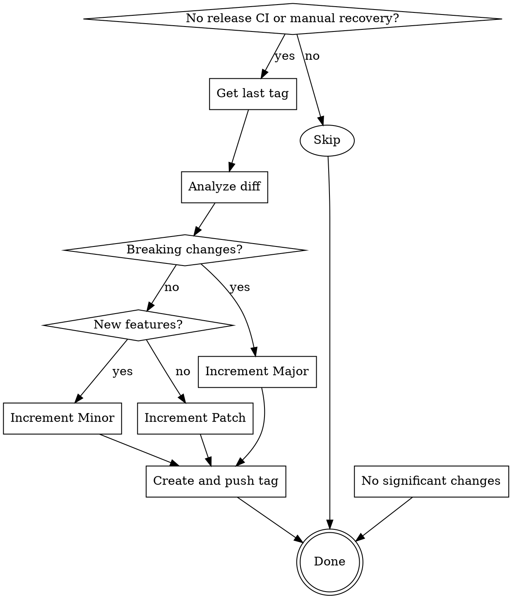

# Auto-Versioning

> **Nota:** el versionado de `main`/`develop` lo automatiza CI (workflows
> `release-stable` y `release-test`); usar esta skill solo para casos
> manuales/reserva.

## Overview

Determines the next semantic version by analyzing code diffs between the last tag and pending changes. Follows SemVer rules: breaking changes → Major, new features → Minor, fixes/docs → Patch.

## When to Use

- Manual versioning in a repo without the release CI workflows (reserve/fallback)
- Backfilling or recovering a tag by hand
- Not for pushes or merges to `main`/`develop`: those are versioned automatically by CI

**Flowchart:**



## When NOT to Use

- Releases de `main`/`develop` (las automatiza CI; esta skill queda como respaldo)
- Committing to feature branches (use manual versioning or skip)
- Hotfix branches (determine version after merge to main)
- Initial project setup (start at v0.1.0 manually)

## Implementation

1. Confirmar que esta skill aplica (solo casos manuales/reserva):
   - ¿El repo tiene los workflows de release CI (`release-stable` / `release-test`)? → **detenerse** (CI ya versiona `main`/`develop`; esta skill no se activa con pushes ni merges)
   - ¿Repo sin release CI o recuperación manual (backfill o tag perdido)? → **continuar**
2. Obtener último tag: `git describe --tags --abbrev=0`
3. Analizar diff: `git diff {last_tag}...HEAD`
4. Clasificar cambios: Major / Minor / Patch (ver Diff Analysis Triggers)
5. Calcular versión siguiente
6. Crear tag: `git tag -a v{version} -m "Release {version}"`
7. Push tag: `git push origin v{version}`

## Quick Reference

| Change Type | Example | Bump |
|---|---|---|
| API removal, signature change | Remove `getUser()` endpoint | Major |
| New feature, new endpoint | Add `exportCSV()` function | Minor |
| Bug fix, docs, refactor | Fix typo, update README | Patch |

## Diff Analysis Triggers

**Major:** Removed public APIs, changed signatures, deleted endpoints, modified schema/config format

**Minor:** Added functions/classes, new endpoints, new features, new config options

**Patch:** Bug fixes, docs, refactoring, performance, tests

## Commands

```bash
# Get last tag
git describe --tags --abbrev=0

# Get diff
git diff {last_tag}...HEAD

# Create tag
git tag -a v{version} -m "Release {version}" && git push origin v{version}
```

## Common Mistakes

| Mistake | Fix |
|---|---|
| Analyzing commit messages only | Always inspect actual code diffs |
| Missing removed APIs | Check for deletions and signature changes |
| Forgetting to push tags | Push immediately after creation |
| Tagging feature branches | Only tag on main branch |
