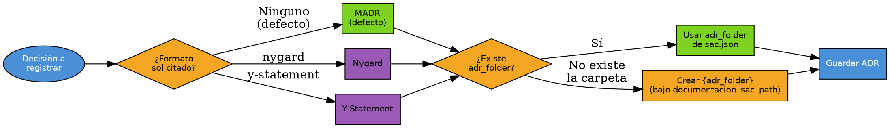

# Registrar Decisiones de Arquitectura (ADRs)

## Overview

Un ADR documenta **una** decisión de arquitectura: contexto, drivers, opciones consideradas, decisión y consecuencias. Usa siempre una de las plantillas de `assets/` — no improvises la estructura.

## Cuando Usar

- Usuario pide crear/registrar/escribir un ADR o "documentar una decisión técnica/arquitectura"
- Se cierra un estudio (spike) o blueprints con una decisión tomada que debe quedar registrada
- Cualquier decisión de diseño con más de una opción viable

Cuándo NO: decisiones triviales reversibles (naming, formato menor) o requisitos que no cambian la arquitectura.

## Decision Flow

## Implementación

### 1. Reunir la decisión (preguntar solo lo que falte)

Leer la config con memctl y tomar `usuario.nombre` → **`{{usuario.nombre}}`**, necesario para firmar el ADR en el paso 6. Si está vacío o la clave no existe, omitir el sufijo de la firma; no inventar un nombre.

Ejecutar cada comando: **su salida ES el valor del placeholder** de su fila y se usa tal cual en el resto de esta skill (no recalcular ni inventar rutas):

| Placeholder / dato | Valor = salida de |
|---|---|
| `{{usuario.nombre}}` | `sh .SAC/memctl.sh get usuario.nombre` |
| `usuario.incluir_firma_en_documentos` | `sh .SAC/memctl.sh get usuario.incluir_firma_en_documentos` |
| `{adr_folder}` | `sh .SAC/memctl.sh get artifacts.adr_folder` |

memctl es solo lectura y su salida ES la respuesta; si memctl no existe (exit 127), leer `.SAC/config/sac.json` con `jq`; si sale con exit 1 (JSON inválido o vacío), detenerse y avisar: no leer ni editar el archivo a mano; nunca inventar valores. `null`, vacío o exit 2 → no configurado.

Elicita estos 6 elementos antes de escribir:
| Elemento | Pregunta |
|---|---|
| Título | ¿Qué decisión se registra? |
| Contexto/Problema | ¿Qué situación motiva la decisión? |
| Drivers | ¿Qué factores pesan (costo, rendimiento, equipo, plazos)? |
| Opciones consideradas | ¿Qué alternativas se evaluaron? |
| Decisión | ¿Cuál se eligió y por qué? |
| Consecuencias | ¿Qué gana y qué paga el equipo? |

Si el usuario no aporta drivers/opciones/consecuencias, pregúntalos — **no los dejes vacíos**.

### 2. Elegir plantilla (`assets/`)

- **Por defecto:** `{file:./assets/adr_madr.md}` (MADR — la más completa)
- Usuario pide "nygard" → `{file:./assets/adr_nygard.md}`
- Usuario pide "y-statement" / "y statement" → `{file:./assets/adr_y_statement.md}`

### 3. Resolver el destino (NO inventes la carpeta)

Orden estricto:
1. `{adr_folder}` = salida de `sh .SAC/memctl.sh get artifacts.adr_folder` (siempre dentro de `documentacion_sac_path`). No preguntar la carpeta ni guardar fuera de ella.
2. **Si la carpeta no existe, créala** antes de guardar el ADR.
3. Si `.SAC/config/sac.json` no existe, la instalación SAC está incompleta: indicar al usuario que ejecute `diat`; no crear el archivo a mano.

### 4. Numeración

- Nombre del archivo: `NNNN-titulo-slug.md` (4 dígitos + slug del título, en minúsculas con guiones).
- Escanea el destino por `*.md` → toma el máximo prefijo `NNNN` y usa `máximo + 1`. **Nunca reinicies en 001** porque parezca un directorio nuevo.
- Rellena el campo de número de la plantilla con el mismo valor.

### 5. Campos obligatorios

- **Estado:** `Propuesto` por defecto (el usuario puede decir Aceptado/Reemplazado/Obsoleto).
- **Decisores:** pregunta quiénes toman la decisión — **no dejes este campo sin autores reales**.
- **Fecha:** hoy (ISO).
- **Consecuencias positivas y negativas:** ambas secciones.
- **Validación** (solo MADR): cómo se sabrá que la decisión fue correcta.
- **Diagrama:** solo si aplica; si no, omítelo.

### 6. Guardar y reportar

Si `usuario.incluir_firma_en_documentos` es `true`, agregar al final del ADR:

> **Arquitecto:** {{usuario.nombre}}
> **Fecha:** {{fecha}}

Sin `usuario.nombre` configurado, la línea queda `> **Arquitecto:**`.

Guarda el archivo en `{adr_folder}` y reporta:
`✅ ADR NNNN: [título] | Formato: [formato] | Ruta: [ruta] | Estado: [estado]`

## Errores Comunes

| Excusa | Realidad |
|--------|----------|
| "Guardo donde parezca lógico" | Ubicación NO determinística → usar `{adr_folder}` (`memctl get artifacts.adr_folder`) |
| "Uso la estructura estándar que recuerdo" | Debes usar la plantilla exacta de `assets/` correspondiente |
| "Omito Decisores/Validación porque no me los dieron" | Son campos obligatorios → preguntar |
| "Reinicio en 001" | Numeración = máximo existente + 1 |
| "Sigo con otra cosa, el registro ya quedó" | Verificar el resumen (ruta, número, estado) antes de terminar |

## Quick Reference

| Acción | Resultado |
|--------|-----------|
| `crea un ADR para <decisión>` | MADR default → `{adr_folder}/NNNN-titulo-slug.md` |
| `...con formato nygard` | `assets/adr_nygard.md` |
| `...y-statement` | `assets/adr_y_statement.md` |
| `{adr_folder}` no existe | La crea bajo `documentacion_sac_path` |