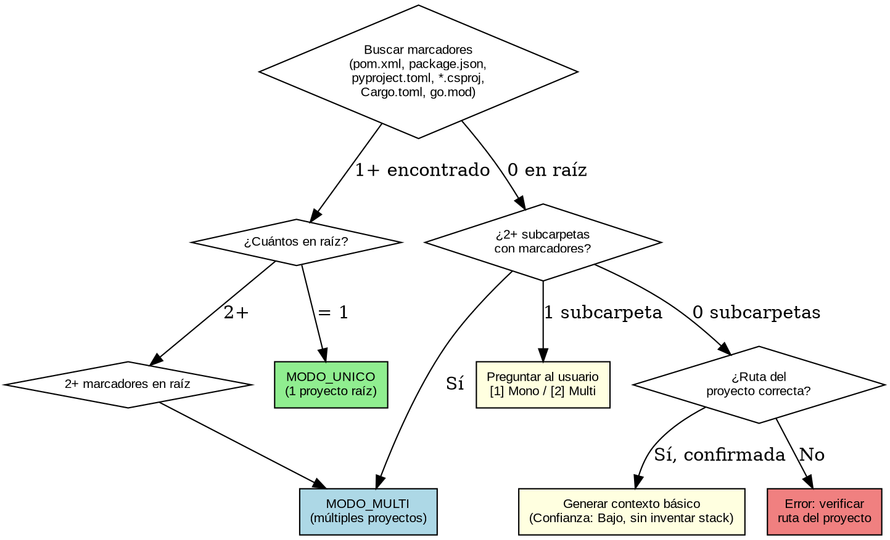

# Tomar Contexto

## Overview
Genera el contexto del proyecto (workspace, scorecard, diagramas y archivos de artifacts) detectando tecnología, arquitectura y DevOps a partir de la configuración del sistema.

## When to Use
- No existe `{workspace}` (workspace.md) o el contexto tiene más de 7 días.
- El usuario solicita analizar o inicializar un proyecto (mono o multi-proyecto).
- Se requiere contexto previo para refinar HUs, planificar o diagnosticar DevOps.

**Cuándo NO usar:**
- `{workspace}` existe Y tiene < 7 días Y usuario no pidió regenerar.
- Usuario solo quiere editar un archivo existente (usar skill específica).
- Ya se ejecutó `tomar_contexto` en esta sesión (evitar duplicar).

## Detección de Workspace



| Caso | Marcadores raíz | Subcarpetas con marcadores | Resultado |
|------|-----------------|---------------------------|-----------|
| Proyecto simple | 1 | 0 | MODO_UNICO |
| Monorepo raíz | 2+ | N/A | MODO_MULTI |
| Monorepo anidado | 0 | 2+ | MODO_MULTI |
| Ambiguo | 0 | 1 | Preguntar |
| Sin proyecto, ruta correcta | 0 | 0 | Generar contexto básico (Confianza: Bajo) |
| Sin proyecto, ruta incorrecta | 0 | 0 | Error: verificar ruta |

## Implementation

### Fase A: Cargar y Confirmar
1. Leer la config con memctl (`documentacion_sac_path` = raíz única donde se crean todas las carpetas y archivos; `hu_folder`, `contextos_folder`, `adr_folder`, `code_smells_folder`, `deuda_tecnica_folder`, `pendientes_folder`, `lecciones_aprendidas` = `artifacts.*`; `backlog`, `reglas_arquitectonicas`, `workspace` = `archivos.*`; `patron_contexto` = `multi_proyecto.patron_contexto`; idioma y `usuario.nombre` → `{{usuario.nombre}}`, usado en la Fase C si `usuario.incluir_firma_en_documentos` es `true`):

```sh
sh .SAC/memctl.sh get usuario.nombre
sh .SAC/memctl.sh get usuario.incluir_firma_en_documentos
sh .SAC/memctl.sh get documentacion_sac_path
sh .SAC/memctl.sh get artifacts.hu_folder
sh .SAC/memctl.sh get artifacts.contextos_folder
sh .SAC/memctl.sh get artifacts.adr_folder
sh .SAC/memctl.sh get artifacts.code_smells_folder
sh .SAC/memctl.sh get artifacts.deuda_tecnica_folder
sh .SAC/memctl.sh get artifacts.pendientes_folder
sh .SAC/memctl.sh get artifacts.lecciones_aprendidas
sh .SAC/memctl.sh get archivos.workspace
sh .SAC/memctl.sh get archivos.backlog
sh .SAC/memctl.sh get archivos.reglas_arquitectonicas
sh .SAC/memctl.sh get multi_proyecto.patron_contexto
sh .SAC/memctl.sh get idiomas.documentacion
sh .SAC/memctl.sh get idiomas.comunicacion
```

memctl es solo lectura y su salida ES la respuesta; si memctl no existe (exit 127), leer `.SAC/config/sac.json` con `jq` o usar `~/.SAC/memctl.sh` (instalación global); si sale con exit 1 (JSON inválido o vacío), detenerse y avisar: no leer ni editar el archivo a mano; nunca inventar valores. `null`, vacío o exit 2 → no configurado.

   Todo lo que esta skill cree debe quedar dentro de `{documentacion_sac_path}`. Sin `.SAC/config/sac.json` (memctl sale con exit 2) → avisar "No hay instalación SAC".
2. Plantillas propias desde `{file:./assets/}` (backlog, contexto, workspace, lecciones_aprendidas, pendientes).
3. Si existe contexto y no hay `--force` → preguntar [U] usar / [R] regenerar.
4. Mostrar profundidad (`--profundidad_analisis`: basico/completo/exhaustivo) y proyectos detectados; esperar confirmación.

### Fase B: Detectar y Analizar
5. Detectar modo según flowchart de arriba.
6. MODO_MULTI → listar proyectos en tabla `# | Proyecto | Stack | Ruta`; filtrar por `--nombre_proyecto` o `--all`, o preguntar.
7. Analizar: stack (lenguaje/framework/versiones), arquitectura (estilo, carpetas, responsabilidades, dependencias inter-proyecto), DevOps (Docker, CI/CD, IaC, puertos) y Scorecard 1-10 (Arq/Stack/Test/DevOps/Docs).
8. Delegar diagramas a sub-agente `mermaid-diagram` (estructura, clases, secuencia).

### Fase C: Generar y Validar
9. Crear artifacts según `{file:references/artifacts-structure.md}`. Crear carpetas de sistema y archivos de contexto (mono: `contexto_proyecto.md` + `workspace.md`; multi: un contexto por proyecto + `workspace.md` Multi). Si `usuario.incluir_firma_en_documentos` es `true`, agregar al final de cada archivo generado: `> **Generado y revisado por:** {{usuario.nombre}}` y `> **Fecha:** {{fecha}}`. Sin `usuario.nombre` configurado, omitir esa línea.
10. Validar documentos → preguntar [OK] / [EDITAR] antes de guardar.

## Quick Reference
| Opción | Valores | Descripción |
|--------|---------|-------------|
| `--profundidad_analisis` | basico, completo, exhaustivo | Nivel de análisis (def. exhaustivo) |
| `--nombre_proyecto` | nombre | Proyecto concreto (multi) |
| `--all` | flag | Analizar todos los proyectos |
| `--force` | flag | Regenerar contexto existente |

## Common Mistakes
| Error | Causa | Solución |
|-------|-------|----------|
| Sin archivos detectables, ruta confirmada correcta | Proyecto realmente vacío | Generar contexto básico: Confianza Bajo, stack "Por definir", sin inventar lenguaje/framework |
| Sin archivos detectables, ruta incorrecta | Se ejecutó fuera de la raíz del proyecto | Verificar ruta y reintentar |
| No se detectó proyecto | Sin marcadores | Ejecutar desde la raíz |
| Proyecto no encontrado | Nombre erróneo (multi) | Listar sin `--nombre_proyecto` |
| Ya existe contexto | Sin `--force` | [R] regenerar o [U] usar existente |
| Modo incorrecto | Ambigüedad en detección | Usar `--nombre_proyecto` o preguntar |
